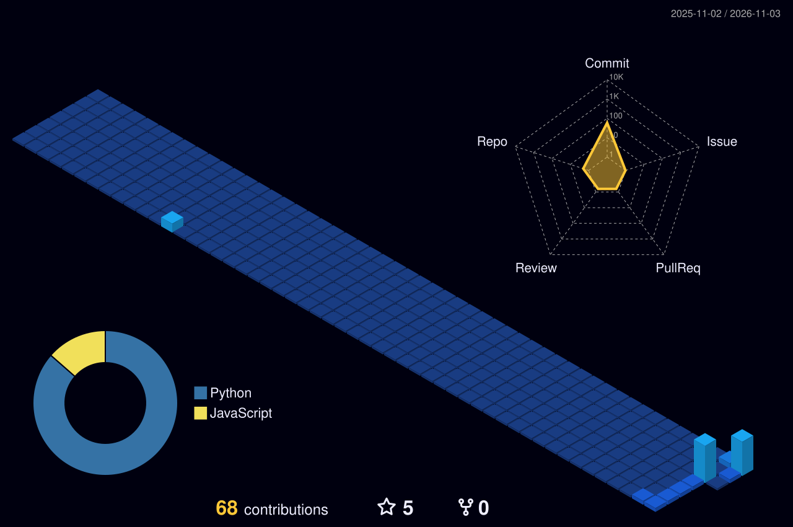

<picture>
  <source media="(prefers-color-scheme: dark)" srcset="./output.gif">
  <source media="(prefers-color-scheme: light)" srcset="./output.gif">
  
</picture>

<h3 align="center">📊 My GitHub Activity</h3>
<a href="https://github.com/midra001?tab=overview">
  
