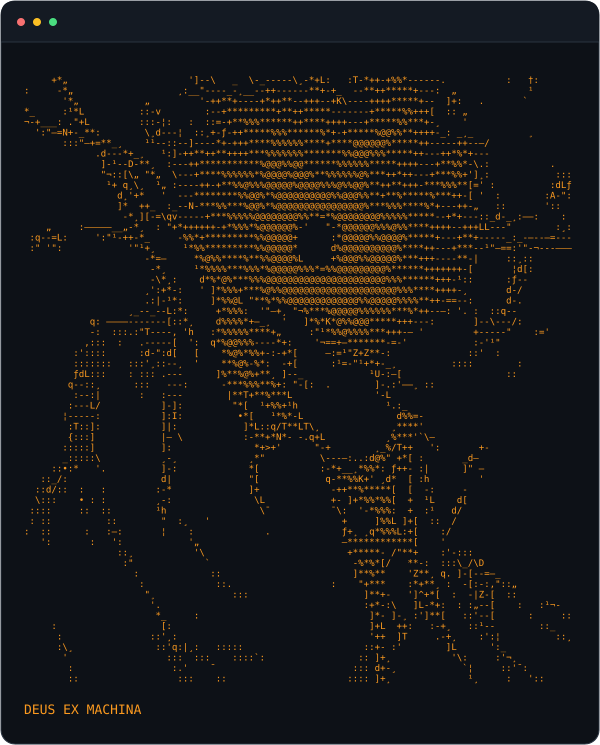

<!-- ASCII panel and individual technology badges are images. All headings, name, bio, and links are real text. -->
<table>
<tr>
<td width="48%" valign="top">
<picture>
  <source media="(prefers-color-scheme: dark)" srcset="./assets/ascii-dark.svg">
  <source media="(prefers-color-scheme: light)" srcset="./assets/ascii-light.svg">
  
</picture>
</td>
<td width="52%" valign="top">

<code>$ whoami</code>

<h1>midra001</h1>

<em>Deus Ex Machina</em>

<h2><code>$ tech --list</code></h2>
<h3>💻 Languages</h3>

<h3>⚛️ Frameworks &amp; Libraries</h3>

<h3>🌐 Web &amp; APIs</h3>

<h3>🗄️ Databases</h3>

<h3>☁️ Cloud &amp; DevOps</h3>

<h3>🛠️ Tools &amp; Platforms</h3>

<h3>🎯 Areas of Interest</h3>

<a href="https://github.com/midra001?tab=repositories">Explore my repositories →</a>

</td>
</tr>
</table>
