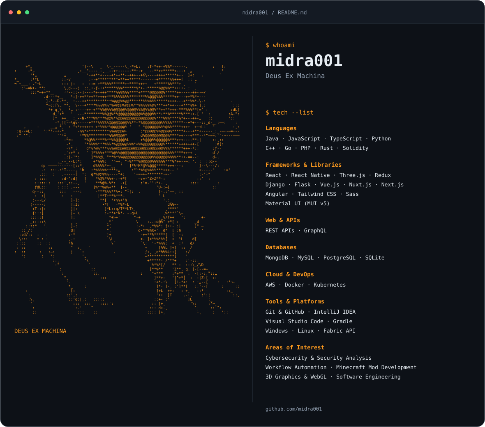

<!-- Profile repository: midra001/midra001. Upload the assets folder too. -->
<picture>
  <source media="(prefers-color-scheme: dark)" srcset="./assets/profile-dark.svg">
  <source media="(prefers-color-scheme: light)" srcset="./assets/profile-light.svg">
  
</picture>

  <a href="https://github.com/midra001?tab=repositories">Explore my repositories</a>

<!-- Layout inspired by https://github.com/Andrew6rant/Andrew6rant.
     Artwork supplied by midra001. ASCII color: #FC9A1F / RGB(252, 154, 31).
     Static SVGs: no trackers, external font requests, or scheduled workflows. -->
